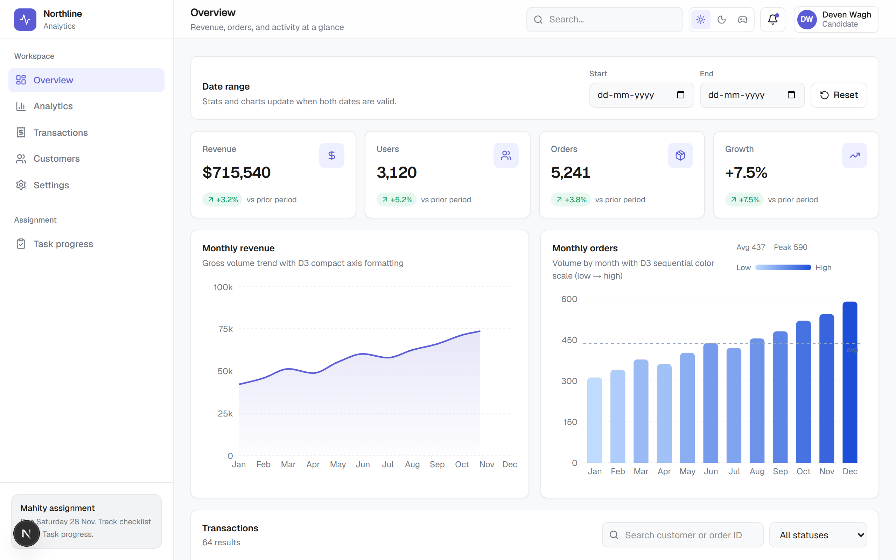
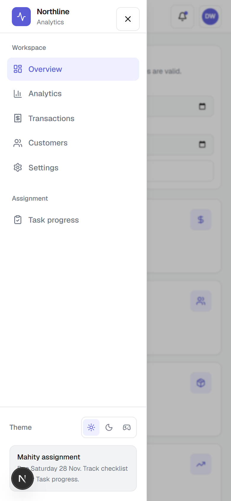
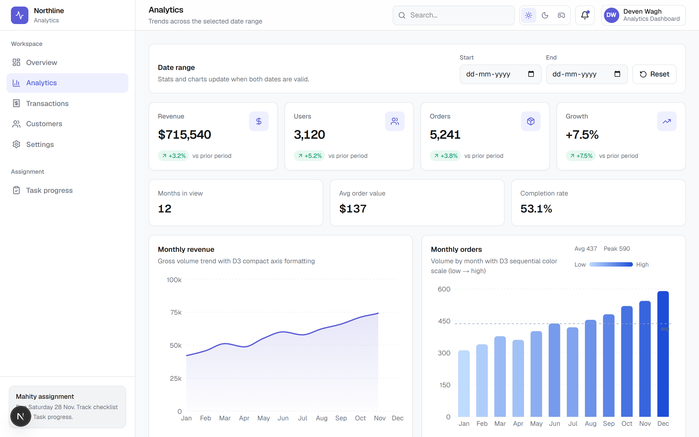
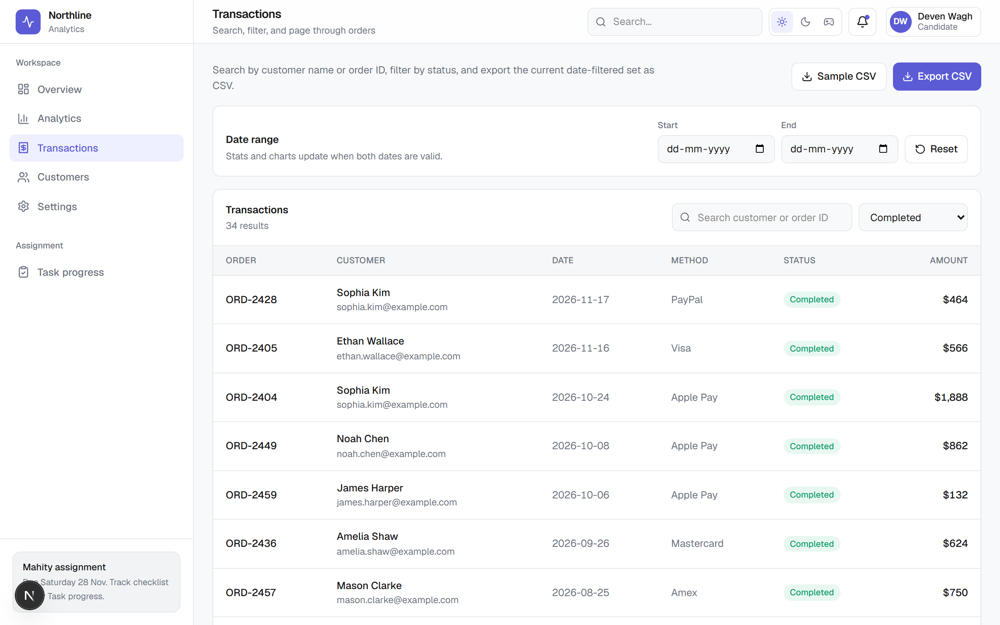
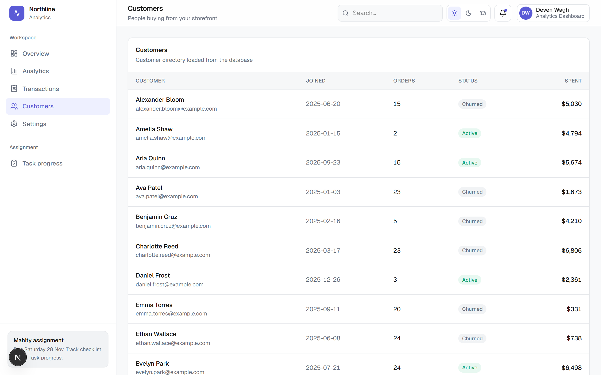
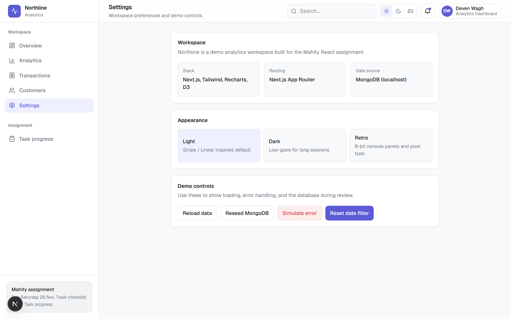
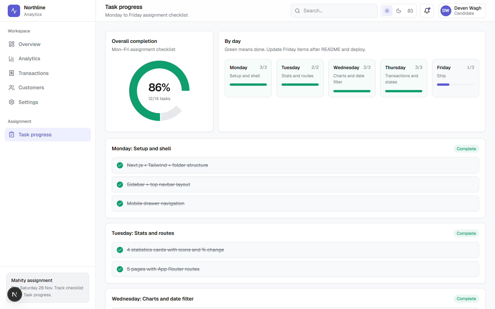
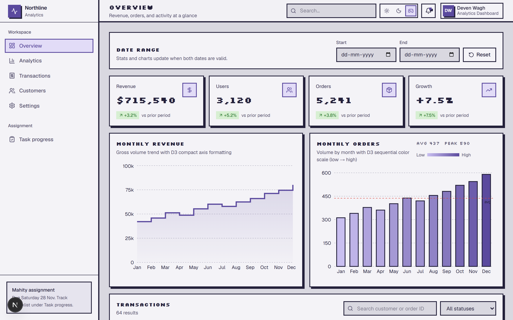

# Northline Analytics Dashboard

1-week Mahity assignment: responsive analytics dashboard built with **Next.js (App Router)**, **TypeScript**, **Tailwind CSS**, and **Recharts**.

> Note: The brief listed React Router. This project uses Next.js file-based routing instead. Confirm with HR if they require CRA + React Router strictly.

## Features

- Sidebar + top navbar (drawer on mobile)
- Overview with 4 stats cards (Revenue, Users, Orders, Growth)
- Line chart (monthly revenue) and bar chart (monthly orders) with tooltips
- Date range filter with reset and invalid-range handling
- Transactions table: search, status filter, pagination, empty state
- Loading and error states (demo controls on Settings)
- Pages: Overview, Analytics, Transactions, Customers, Settings
- **Task progress** page with completion chart and Mon–Fri checklist
- Bonus: CSV export on Transactions

## Stack

| Tool | Role |
|------|------|
| Next.js 16 | App, routing, deploy target |
| TypeScript | Typed components and data |
| Tailwind CSS 4 | Layout and theme |
| Recharts | Chart rendering |
| D3 | Color scales, averages, number formats |
| Lucide React | Icons |
| date-fns | Date validation / filtering |

## Getting started

```bash
cd analytics-dashboard
bun install
bun run dev
```

Open the local dev server URL shown in your terminal.

## Scripts

```bash
bun run dev    # local development
bun run build  # production build
bun run start  # serve production build
bun run lint   # ESLint
```

## Project structure

```text
src/
  app/                 # routes (overview, analytics, transactions, …)
  components/
    layout/            # sidebar, navbar, shell
    stats/             # reusable stat cards
    charts/            # revenue line + orders bar
    filters/           # date range filter
    transactions/      # table + status badge
    progress/          # assignment status chart
    ui/                # loading, error, empty
  context/             # dashboard date + data state
  data/                # mock series, transactions, checklist
  lib/                 # utils, filters, csv
```

## Design

Stripe / Linear inspired light theme:

- Background `#F8F9FA`, white surfaces, charcoal text `#171717`
- Muted indigo accent `#5B5BD6`
- Geist typography, 8–12px radius, minimal shadows
- Dense but calm dashboard layout

## Data / database (MongoDB)

1. Start MongoDB locally or use a MongoDB connection string
2. Copy `.env.example` to `.env.local` and set `MONGODB_URI`
3. `bun run dev`: the first request to `/api/dashboard` seeds the database automatically

If MongoDB is not running, the app falls back to built-in sample data.

- Live export: **Transactions → Export CSV** (filtered rows)
- Static sample: [`public/sample-transactions.csv`](./public/sample-transactions.csv) or **Sample CSV** on the Transactions page
- Reseed: **Settings → Reseed MongoDB**

## Themes

Light (default), Dark, and Retro (8-bit) via `next-themes`. Switch in the navbar or Settings.

## Deploy (Vercel)

1. Push this folder to GitHub
2. Import the repo in [Vercel](https://vercel.com)
3. Framework preset: Next.js (auto-detected)
4. Deploy

Root directory should be `analytics-dashboard` if the repo parent also contains other folders.

## Screenshots

### 1. Overview (desktop)


### 2. Overview (mobile drawer)


### 3. Analytics


### 4. Transactions (with filters)


### 5. Customers


### 6. Settings


### 7. Task progress


### 8. Retro / Pixel theme (Overview)


## Author

Deven Ishwar Wagh  
9326126931  
wagh1.2.3.002@gmail.com
